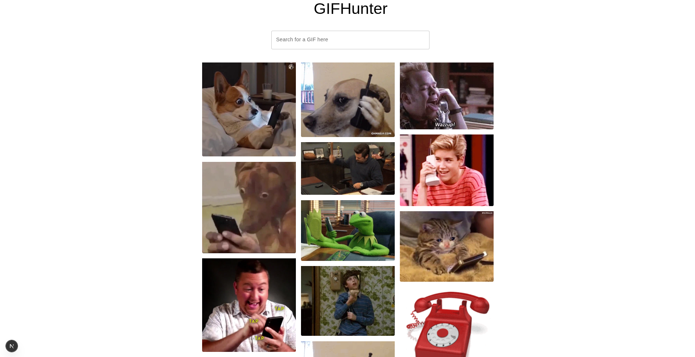
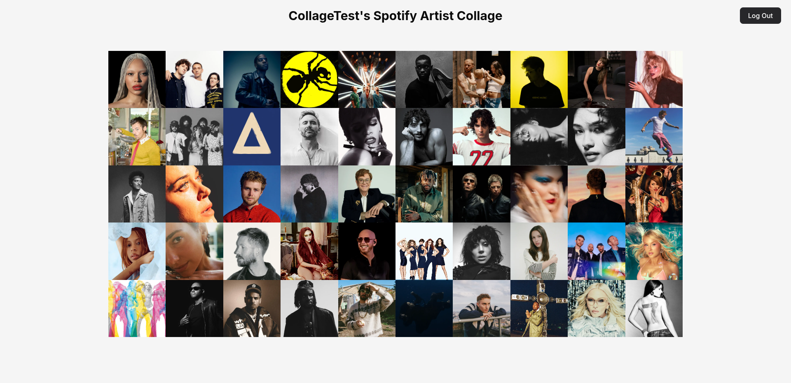

# han-tiet.com

The source for [han-tiet.com](https://han-tiet.com), my personal portfolio site. It is built with Next.js 16 (App Router) and React 19 and deployed on Vercel.

## Tech Stack

- **Framework:** Next.js 16 (App Router, Turbopack), React 19, TypeScript
- **Styling:** Tailwind CSS v4, shadcn/ui (Radix)
- **Animation:** Motion (framer-motion)
- **Form:** AWS SES (with an SNS webhook for bounces and complaints), zod (validation)
- **Observability:** Sentry, Vercel Analytics
- **Testing:** Vitest, Testing Library (jsdom), Playwright

## Project Structure

```
e2e/                        Playwright end-to-end tests
prisma/                     Prisma schema and migrations (Better Auth models)
public/                     Static assets
src/
├── app/                    App Router routes
│   ├── actions/            Server actions (contact form)
│   ├── api/                SNS webhook for SES bounces and complaints
│   ├── contact/            /contact
│   └── projects/           /projects and the demo app routes
│       ├── gif-hunter/
│       └── spotify-artist-collage/
├── components/             Shared site components
│   └── ui/                 shadcn/ui primitives
├── constants/routes.ts     All internal routes (use ROUTES, not string literals)
├── data/projects.ts        Project cards shown on /projects
├── features/               Components for each demo app
│   ├── gif-hunter/
│   └── spotify-artist-collage/
├── generated/prisma/       Generated Prisma client (gitignored)
└── lib/                    Auth, Prisma client, SES helpers, unit tests (*.test.ts)
```

The path alias `@/*` maps to `src/*`.

## Portfolio Projects

### GIFHunter - <a href="https://han-tiet.com/projects/gif-hunter">Project link</a>



A GIF search engine that queries Giphy and Klipy in parallel and displays the results from both sources.

#### Tech Stack

- Framework: Next.js 16, React 19, TypeScript
- Styling: Tailwind CSS v4, MUI
- Testing: Vitest (unit tests for `fetchResults` and `APIErrorMessage`), Playwright (end-to-end search test)

#### Features

- Index page: The user can type a query into the search bar to search for GIFs related to it.
- Results page: Loads and displays GIFs to the user based on their search query. The search query persists in the search bar.

#### Areas of Interest

- `src/features/gif-hunter/lib/fetchResults.ts` (<a href="https://github.com/han-tiet/han-tiet.com/blob/main/src/features/gif-hunter/lib/fetchResults.ts">Link</a>) - fetches from each API in parallel and normalises the different response shapes into one `Gif` type.
- `src/features/gif-hunter/components/Results.tsx` (<a href="https://github.com/han-tiet/han-tiet.com/blob/main/src/features/gif-hunter/components/Results.tsx">Link</a>) - displays GIFs in a Material UI mosaic component after they have all been fetched. If an API cannot be accessed, displays GIFs from any remaining available API(s) and an error message about inaccessible API(s).
- `src/features/gif-hunter/components/SearchBar.tsx` (<a href="https://github.com/han-tiet/han-tiet.com/blob/main/src/features/gif-hunter/components/SearchBar.tsx">Link</a>) - submits an input via a form as a `searchParam`, which is then appended to the URL and fetched by `fetchResults`.

#### Challenges

- When simulating a situation where one of the two APIs could not be reached, the user would be redirected to the error page even though the other API could still be accessed. This was caused by the promises from both API fetch functions being awaited in a `Promise.all`, which throws an error as long as one of the promises is rejected. Changing `Promise.all` to `Promise.allSettled` fixed the issue since `Promise.allSettled` waits for every promise and reports each one's outcome instead of rejecting on the first failure.

- If a query was searched while another query was being fetched, the website would sometimes hang indefinitely without displaying results for either query. This was caused by the `<Results>` component not unmounting after a new search, leading to some GIFs from the second query not being counted and the `allLoaded` condition required to display GIFs not being fulfilled. This issue was fixed by adding a key to `<Results>`, which allowed it to unmount and remount with each new search. Also, the count function was changed to a callback function that counted both cached and uncached GIFs, so `allLoaded` can be consistently met and the website can display GIFs.

#### Testing

- **Unit tests (Vitest)** - `src/lib/gifhunter-merge.test.ts` (<a href="https://github.com/han-tiet/han-tiet.com/blob/main/src/lib/gifhunter-merge.test.ts">Link</a>): 18 tests that mock `fetch` with a URL-routed stub, so no API keys or network are needed.
  - `fetchResults` (14 tests): merges both providers (Giphy first, then Klipy) into the shared `{ key, src, id, title }` shape and checks that keys stay unique when both providers return the same ID. It also checks partial failure: when one API rejects, returns HTTP 500 or sends a malformed body, the results from the other API are still returned and the failure shows up in `status1`/`status2`. Further tests check that each request carries the correct API key and the URL-encoded query (e.g. `cats & dogs #1`).
  - `APIErrorMessage` (4 tests): returns nothing when both APIs succeed, names the failing API otherwise, and reports Giphy first when both fail.
- **End-to-end tests (Playwright)** - `e2e/app.spec.ts` (<a href="https://github.com/han-tiet/han-tiet.com/blob/main/e2e/app.spec.ts">Link</a>): run on desktop, phone and landscape-phone viewports.
  - The index page loads without page errors and shows the GIFHunter header link.
  - A search for `cat` keeps the query in the search bar on the results page. This test is tagged `@live` because it calls the real Giphy and Klipy APIs. Skip it with `npm run test:e2e -- --grep-invert @live`.

#### Known Issues

- None as of v1.2.1

#### Potential Additions

- More API sources
- Options for downloading GIFs at different resolutions
- List of filters (e.g. sources, NSFW, AI-generated GIFs)

### Spotify Artist Collage - <a href="https://han-tiet.com/projects/spotify-artist-collage">Project link</a>



Signs into Spotify with OAuth (via Better Auth) and builds a collage of the user's top 50 most listened to artists.

#### Tech Stack

- Framework: Next.js 16, React 19, TypeScript
- Styling: Tailwind CSS v4, shadcn (Radix)
- Backend: PostgreSQL, Prisma 7
- Auth: OAuth via Better Auth
- Testing: Playwright (end-to-end login and logged-out redirect tests)

#### Features

- Login page: The user can click on a button to log in to and authenticate their Spotify account.
- Collage page: After successful authentication, sequentially fades in profile images of the user's top 50 most listened to Spotify artists to create a collage.

#### Areas of Interest

- `src/app/projects/spotify-artist-collage/page.tsx` (<a href="https://github.com/han-tiet/han-tiet.com/blob/main/src/app/projects/spotify-artist-collage/page.tsx">Link</a>) - fetches the access token from Spotify's API, authenticates the user and fetches the user's name and most listened to artists. The user's name is then displayed in the navigation bar.
- `src/features/spotify-artist-collage/src/components/Collage.tsx` (<a href="https://github.com/han-tiet/han-tiet.com/blob/main/src/features/spotify-artist-collage/src/components/Collage.tsx">Link</a>) - sequentially loads in profile images of the user's top 50 most listened to Spotify artists with a fade-up animation to create a collage. When an image is hovered over, an overlay fades in showing the artist's rank and name, and when an image is clicked, the user is redirected to the artist's Spotify page.

#### Challenges

- Trying to log in led to the website returning an API error even though logins were previously successful. This was caused by Better Auth 1.7 changing what IDs are accepted by `getAccessToken`. Instead of `providerId`, `getAccessToken` now requires an `accountId` passed to it for OAuth login to be successful. To solve the issue, the fetch logic was changed so that `accountId` was passed from headers to `getAccessToken` and `providerId` was removed.

- Since multiple users will be logging into this website, a database was required to securely store user data. Initially, MySQL was considered due to being low-cost and secure. However, it was found that hosting the project on Vercel meant that traditional methods of backend integration would not be supported. In the end, the project would connect to a PostgreSQL database via the Prisma ORM, since this setup was the only one that was compatible with Vercel while using a relational database.

#### Testing

- **End-to-end tests (Playwright)** - `e2e/app.spec.ts` (<a href="https://github.com/han-tiet/han-tiet.com/blob/main/e2e/app.spec.ts">Link</a>): run on desktop, phone and landscape-phone viewports. They never sign in to a real Spotify account.
  - The login page loads without page errors and shows the "Log In With Spotify" button.
  - Visiting the collage page while logged out redirects to the login page, which shows the server-side session check is working.
  - Clicking the login button starts the OAuth flow and sends the user to `accounts.spotify.com`. That page is stubbed with `page.route`, so the test does not depend on Spotify.

#### Known Issues

- None as of v1.2.1

#### Potential Additions

- Other music streaming services (Apple Music, Amazon Music, etc.)
- More unique methods of displaying artists (Three.js for 3D components)

## Contributing Workflow

- **Branches:** feature branches are named after their ticket (`HAN-NNN`) and are branched from and merged into `develop`. `main` is production. Releases are merged from `develop` into `main`. Hotfixes use `vX.Y.Z` branches that are merged into `main` and then back into `develop`.
- **Commits:** messages must follow [Conventional Commits](https://www.conventionalcommits.org/) (`feat:`, `fix:`, `chore:` …). commitlint enforces this.
- **Git hooks (Husky):**
  - `pre-commit` runs ESLint, lint-staged and Prettier
  - `pre-push` runs `prettier . --check`
  - `commit-msg` runs commitlint
- **Pull requests:** templates for feature, release and hotfix PRs are in `.github/`.

## License

[MIT](LICENSE) © Han Tiet
